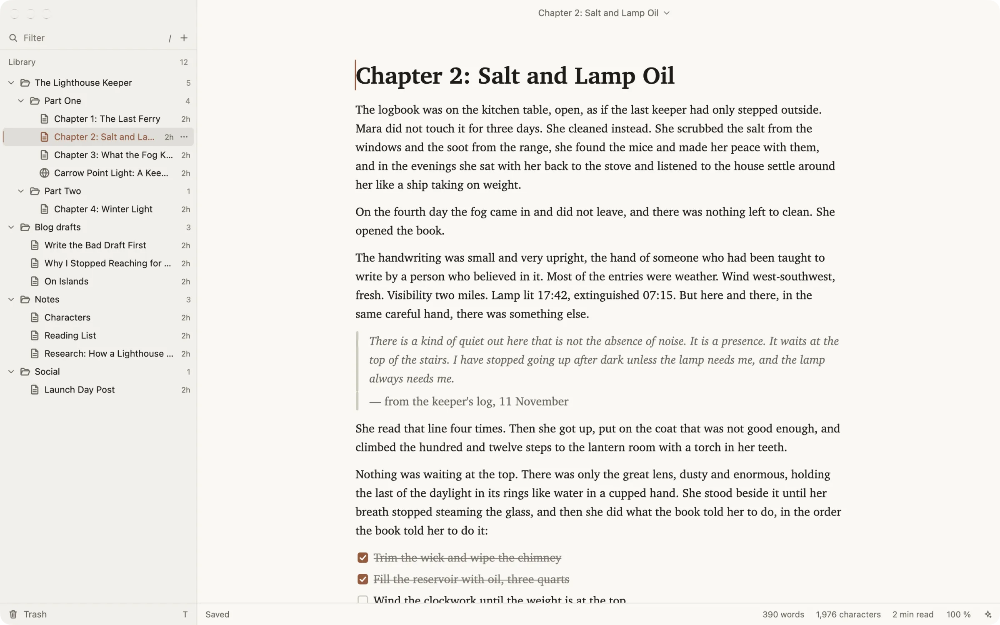

# Inner Word

Inner Word is a rich-text writing app for macOS, for books, blog posts and social posts.
Everything in it can be done from the keyboard, and everything can be done with the mouse.
Your library of folders and documents is a folder on your own Mac, kept in SQLite. There is
no account and no subscription. It is written in Rust on
[GPUI](https://crates.io/crates/gpui), the UI framework made by the Zed team.

<picture>
  <source media="(prefers-color-scheme: dark)" srcset="site/assets/hero-dark.webp">
  
</picture>

Website: <https://innerword.io/>

## Download

Download the disk image from [GitHub Releases](https://github.com/BasalBit/inner_word/releases):

- `Inner-Word-<version>-universal.dmg` runs on any Mac, Apple silicon or Intel.
- `Inner-Word-<version>-arm64.dmg` is for Apple silicon only, and smaller.

Open the disk image, drag Inner Word onto the Applications folder, and eject the image.

### The first launch is blocked. That is expected.

The app is signed ad hoc only. It is not signed with an Apple developer certificate and not
notarised by Apple, so macOS refuses to open it the first time. You approve it once. After
that it opens like any other app.

The quickest way is one command in Terminal, after the app is in Applications:

```bash
xattr -dr com.apple.quarantine "/Applications/Inner Word.app"
```

This removes the "downloaded from the internet" mark from the app, and from the `innerword`
tool inside it. You can also approve it in System Settings > Privacy & Security > Open
Anyway. "Read Me First.txt" on the disk image has both ways step by step.

### Requirements

- macOS 10.15.7 or later on an Intel Mac.
- macOS 11 or later on a Mac with Apple silicon.
- Pages (saved web pages) and whiteboards need macOS 12.3 or later. On an older macOS a page
  shows its text, a whiteboard the list of its elements, and neither can be added.

## What it does

- **Rich text.** Headings, lists, to-do lists, quotes, code blocks, dividers, page breaks,
  links, highlights, text colours and fonts. Markdown-style input rules, a format menu
  (`cmd-.`), an insert menu (`/`) and a format bar over a mouse selection. No toolbar.
- **Two views.** A single column (flow view) and page view with real paper, margins and page
  numbers. A zoom that changes nothing in the document.
- **A library.** Folders and documents, quick open, full-text search, a trash, version
  history, autosave and a daily backup. Nothing has a save button, and text is never lost.
- **Comments.** Threads anchored to the text, with replies and resolve.
- **Pictures** in documents: insert, paste, drop from the Finder, resize, align, describe.
- **Pages.** A web page (an HTML file or a folder, a claude.ai artifact among them) kept in
  the library and shown in WebKit, offline for good.
- **Whiteboards.** Excalidraw built into the app and offline: shapes, arrows, text, frames,
  pictures and Mermaid to drawing, saved as you draw, with versions, the trash and search,
  exported and printed as a PDF.
- **Export and print.** Markdown, DOCX, plain text and PDF, of a document or a whole folder.
  Print through the macOS print panel, laid out as page view shows it.
- **Spell checking** with the macOS spell checker, in the language of each paragraph or one
  you choose.
- **Vim mode**, which can be turned on and off.
- **Keys.** A command palette (`cmd-shift-p`), and every keyboard shortcut can be changed,
  exported and imported.
- **Mouse.** A right-click menu on every object, a complete menu bar, and `ctrl-enter` or
  `shift-f10` to open the same menus from the keyboard.

## Agents and the assistant

Both are optional. Inner Word works fully without either.

- **Agents.** The app bundle holds a command line tool,
  `/Applications/Inner Word.app/Contents/MacOS/innerword`, and the same tool is an MCP server
  (`innerword mcp`). Any agent that can run a command or speak MCP (Claude Code, Codex, Gemini
  CLI and others) can use them to find,
  read, create, edit, comment on and export documents in your library, and to draw on
  whiteboards. They work while the
  app is closed and while it is open: then the app makes the change, keeps a version of the
  document first, and says so in a note with Undo. Inner Word > Agents... installs a skill
  that tells your agents about the tool, and shows the command that adds the MCP server to
  each agent. Nothing is installed until you press a button there, and the app never edits
  an agent's configuration.
- **The assistant.** A quick chat at the selection (`cmd-j`) and a side chat (`cmd-3`) that
  advise. An answer changes a document only when you press one of its buttons. Beside a
  whiteboard the side chat can answer with a drawing, which Draw (`cmd-shift-d`) puts on
  the canvas as one step of undo, with a version kept first. Beside a document or a saved
  web page, New Whiteboard makes the drawing into a new whiteboard. The
  assistant runs on Claude Code today, through your own sign-in and plan. Other engines are
  planned. It appears only when Claude Code is installed, and it can be switched off in the
  settings.

## Privacy and network

Inner Word has no account, no telemetry, no update check and no crash reports. It reaches
the network only in these cases, each one started by you or by something you installed:

1. **Adding a page.** When you add a page (File > Import Page..., a drop, or an agent's
   `innerword page add`), `/usr/bin/curl` fetches the public addresses the page names, once.
   Showing a page later never touches the network.
2. **The assistant.** At launch and when the settings open, the app runs your `claude
   --version` and `claude auth status` to see whether Claude Code is installed and signed in.
   A message you send goes to Anthropic through Claude Code. Nothing is sent before you send
   a message.
3. **Links.** A link in a text or a page, a page's address, or a documentation link in the
   Agents panel opens in your default browser, only on a click or a command.
4. **Shown pages are offline.** WebKit's content rules and a Content-Security-Policy block
   every request from a page to the network.
5. **Spelling** uses the macOS spell checker on your Mac.

Your library is in `~/Library/Application Support/Inner Word`: `library.db` holds the
documents, `images.db` the pictures and the files of pages. Removing the app does not remove
them.

## Building from source

Inner Word builds on macOS only. It uses AppKit, WebKit, ImageIO, PDFKit and the macOS spell
checker.

You need:

- Xcode or the Command Line Tools for Xcode.
- Rust through [rustup](https://rustup.rs). The toolchain is pinned in
  [`rust-toolchain.toml`](rust-toolchain.toml), and rustup installs it on the first build.
- No offline Metal compiler: GPUI is built with `runtime_shaders`, so the shaders are
  compiled when the app starts.

```bash
cargo build -p innerword-app            # debug build

# Run the app against a throwaway library
mkdir -p /tmp/inner-word-dev
INNER_WORD_DATA_DIR=/tmp/inner-word-dev cargo run -p innerword-app
```

**Always set `INNER_WORD_DATA_DIR` to a temporary folder when you run a build from source.**
Without it the app opens your real library in `~/Library/Application Support/Inner Word`.
If you still have a library from The Writer, the first run without it moves that real
folder to the new name. The `innerword` tool takes `--library <dir>` for the same purpose.

`scripts/bundle.sh` builds the release app and the disk image in `dist/`
(`--universal` for arm64 and x86_64 in one binary). [CONTRIBUTING.md](CONTRIBUTING.md) has
the test commands and the rules for working on the code.

## Workspace layout

| Crate | What it is |
|---|---|
| `innerword-core` | The document model and the headless editing engine: selection, commands, undo, comments, search. No GPUI, no IO. |
| `innerword-store` | The SQLite library: folders, documents, settings, search, versions, backups, the bytes of pictures and pages. |
| `innerword-image` | Image files made into what the library stores (ImageIO). |
| `innerword-page` | The bundler of pages: an HTML file or folder to the files a page is served from, every piece from the web fetched once. |
| `innerword-board` | A whiteboard's scene in Rust: its stored form, its listing, agents' and the assistant's drawings made into Excalidraw's elements, the merge. |
| `innerword-board-web` | Excalidraw built offline (`web/`, the committed `dist/`) and the bridge's contract with the app. |
| `innerword-web` | Everything that talks to WebKit: the view of an open page or a whiteboard, the offline check, the PDF of a page. |
| `innerword-print` | Printed pages as data, the PDF writer, a PDF reader for tests, the macOS print operation. |
| `innerword-export` | Markdown, DOCX and plain-text export, and the Markdown importer. |
| `innerword-vim` | The Vim engine over the editing engine. |
| `innerword-ui` | Theme tokens and shared widgets: text field, picker, modal, context menu, toasts, key hints. |
| `innerword-editor` | The rich-text editor: layout, flow and page view, zoom, input, images, the print pass. |
| `innerword-editor-tools` | The overlays around the text: format menu, insert menu, link, font picker, find and replace, context menus, format bar. |
| `innerword-vim-mode` | Attaches the Vim engine to the editor. |
| `innerword-comments` | The comments panel. |
| `innerword-spell` | Spell checking over `NSSpellChecker`, with a fake for tests. |
| `innerword-library` | The library model and the library sidebar. |
| `innerword-keymap` | Keyboard shortcuts as data: defaults, the user's changes, conflicts, the shortcuts file. |
| `innerword-keymap-ui` | The "Keyboard shortcuts" list. |
| `innerword-assistant` | The assistant's engine: the backend interface, the Claude Code backend, a fake backend, the conversation model, the drawings in answers. |
| `innerword-assistant-ui` | The assistant's shared chat components and the side chat. |
| `innerword-assistant-quick` | The quick chat at the selection. |
| `innerword-agent` | The command layer for agents: every operation on the library, with a version kept before each change. |
| `innerword-mcp` | The MCP server protocol layer. |
| `innerword-cli` | The `innerword` command line tool and `innerword mcp`. |
| `innerword-agent-setup` | What is known about the agents on a Mac, the skill, installing and removing it. |
| `innerword-app` | The app (`inner-word`): window, workspace, palette, settings, menus, and everything above mounted together. |

[CLAUDE.md](CLAUDE.md) has the full map, the dependency rules and the details of every
feature. [docs/gpui-notes.md](docs/gpui-notes.md) has verified notes on the GPUI version used.

## The former name

Until version 0.9.0 Inner Word was called The Writer. The first launch of Inner Word moves an
existing library from `~/Library/Application Support/The Writer` to the new folder and leaves
a link under the old name. A few saved names keep the old spelling on purpose, so that
existing libraries and files stay readable.

## How it was built

Inner Word was built with heavy help from AI coding agents. That is why
[CLAUDE.md](CLAUDE.md) exists: it is the engineering notebook those agents work from, and it
is the most detailed description of the code. [AGENTS.md](AGENTS.md) points other agents to
it.

## More

- [CONTRIBUTING.md](CONTRIBUTING.md): how to build, test and send a change.
- [SECURITY.md](SECURITY.md): how to report a vulnerability privately.
- [CODE_OF_CONDUCT.md](CODE_OF_CONDUCT.md)
- [CHANGELOG.md](CHANGELOG.md)
- Website: <https://innerword.io/>

## License

Inner Word is released under the [MIT License](LICENSE), Copyright (c) 2026 BasalBit. The
licenses of the third-party crates it is built from are in
[THIRD-PARTY-LICENSES.txt](THIRD-PARTY-LICENSES.txt), which also ships inside the app and on
the disk image.

Inner Word is an independent project. It is not affiliated with or endorsed by Apple,
Anthropic, OpenAI, Google, GitHub or the makers of the other agents named here. Their names
are trademarks of their owners.
